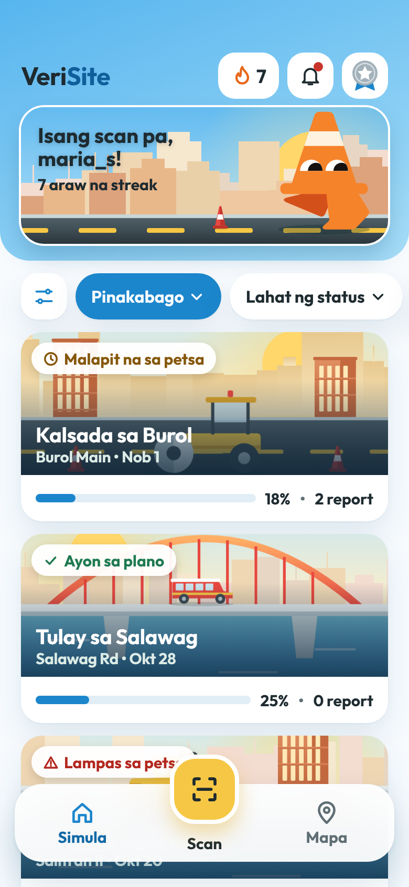
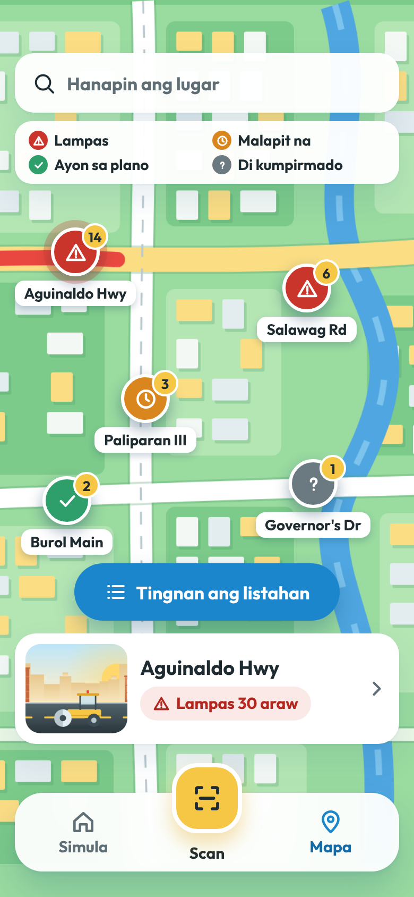

#VeriSite

> 🏆 **2nd Runner-Up (PLDT AI in 30 Hours)** — Built in 30 hours to make Philippine public works transparent, verifiable, and safe for everyday commuters.

**VeriSite** is a mobile-first Progressive Web App (PWA) for road-work transparency and hazard reporting in the Philippines. Citizens point their phone camera at a DPWH/LGU construction signboard (*paskil*) or an unguarded road excavation (*maling hukay*), and the app reads the sign with vision AI, cross-checks it against official [DPWH Transparency Portal](https://transparency.dpwh.gov.ph) records, flags missing barricades or warning lights, and drafts a pre-filled report or official DPWH complaint in seconds.

<p align="center">
  
  
</p>

---

## Key Features

- **AI Signboard (*Paskil*) & Hazard Scanner (`/verisite/scan`, `/api/analyze`):**
  - Uses Google Gemini Flash Lite (`@google/genai`) with structured JSON output to extract `contract_id`, `title`, `contractor`, `implementing_office`, `budget_php`, `start_date`, and `target_date` while simultaneously checking for `open_excavation`, `barricade_visible`, and `warning_light_visible`.
  - Handles real-world OCR lookalikes (`0`, `O`, `D`) in 8-character DPWH contract IDs (e.g., `25OD0106`, `24DF0012`) and queries candidate variants against Supabase (`ensureProjectByContractId`).
  - Checks image brightness client-side before upload, strips EXIF metadata via canvas JPEG re-encoding (`lib/image.ts`), and falls back gracefully when offline or rate-limited.
- **Signboard vs. Official Record Verification (`/verisite/result`):**
  - Automatically compares the scanned billboard against the imported DPWH record (`signChecks` in `app/verisite/store.ts`) and flags mismatches in budget (>1% variance), target completion date, contractor name, or implementing office.
- **Interactive Map & Urgency Scoring (`/verisite/map`, `/verisite/priority`, `/verisite/lgu`):**
  - MapLibre GL map loads real DPWH projects in the active viewport (`loadViewportProjects`) alongside local citizen reports.
  - Ranks sites with a 0–100 **Urgency Score** (`scoreOf` in `app/verisite/store.ts`): citizen report volume (up to 45 pts) + unresolved safety hazards (`Bukas na hukay` 20 pts, `Walang harang` 10 pts, `Walang ilaw` 5 pts) + days past target completion date (up to 20 pts).
- **Citizen Reporting, Badges & LGU Moderation (`/verisite/report`, `/verisite/badges`, `/admin`):**
  - Tagalog-first civic UI with daily reporting streaks, 5 reporter badge tiers (*Baguhan*, *Tanso*, *Pilak*, *Ginto*, *Diyamante*), project following, and a large-text accessibility toggle (*Malaking titik*).
  - LGU status tracking (`bago` → `tinitingnan` → `naaksyunan`), admin moderation queue (`/admin`), and one-tap pre-filled email complaints (`buildComplaintMailto` → `citizens_feedback@dpwh.gov.ph` for verified DPWH contracts).
- **Real DPWH Transparency Data Importers (`scripts/`):**
  - Python scripts load provincial snapshots or individual contracts from the [BetterGov.PH DPWH Transparency Portal Parquet dataset](https://huggingface.co/datasets/bettergovph/dpwh-transparency-data) into Supabase Postgres.

---

## Tech Stack

| Layer | Technology |
|---|---|
| **Frontend / PWA** | Next.js 16 (App Router), React 19, TypeScript, Tailwind CSS v4 |
| **Maps** | MapLibre GL (`maplibre-gl`) + OpenFreeMap tiles + illustrated neighborhood view |
| **Backend / Database / Auth** | Supabase (PostgreSQL, Row-Level Security, Google OAuth & Anonymous Auth, Public `photos` Storage bucket) |
| **Vision AI** | Google Gemini API (`@google/genai`, `gemini-3.5-flash-lite` / `gemini-2.5-flash-lite`) |
| **Data Pipeline** | Python 3, `pandas`, `pyarrow`, `requests` |

---

## Repository Structure

```text
bantayasenso/
├── bantayasenso/                  # Next.js 16 PWA application
│   ├── app/
│   │   ├── api/analyze/route.ts   # Server-side Gemini vision endpoint (sign OCR + hazard detection)
│   │   ├── verisite/              # Primary Tagalog-first civic app (18 screens + hybrid Supabase/local store)
│   │   │   ├── store.ts           # Pure domain logic: urgency score, sign verification, badges, streaks
│   │   │   ├── data.ts            # Hybrid localStorage + Supabase viewport/report/OAuth sync layer
│   │   │   ├── ai.ts              # Client AI caller, brightness check, contract ID lookup, fallback
│   │   │   └── *.test.mjs         # Node test suites for store and filter logic
│   │   ├── scan/page.tsx          # Direct scanner view
│   │   ├── admin/page.tsx         # LGU / Admin report moderation & official response queue
│   │   └── manifest.ts            # Installable PWA web manifest
│   ├── components/                # Shared UI components (IllustratedMap, ProjectCard, SitePin, StatusLabel, etc.)
│   ├── lib/
│   │   ├── supabase.ts            # Supabase client, Google OAuth helpers, contract ID normalizer, mailto builder
│   │   └── image.ts               # Client-side canvas resize (<=1600px) & EXIF-stripping JPEG encoder
│   ├── scripts/
│   │   ├── import_dpwh.py         # Batch Parquet-to-Supabase DPWH project importer
│   │   ├── import_single_contract.py # Single contract importer with optional lat/lng override
│   │   └── test_import_dpwh.py    # Unit tests for DPWH row normalization
│   └── supabase/migrations/       # SQL migrations (schema, status views, RLS, report likes & timeline)
└── docs/
    ├── PRD.md                     # Product Requirements Document
    ├── IMPLEMENTATION.md          # Initial technical implementation blueprint & SQL schema
    └── verisite-design/           # HTML screen prototypes, design rules, and visual assets
```

---

## Getting Started

### 1. Install dependencies

```bash
cd bantayasenso
npm install
```

### 2. Configure environment variables

Create `bantayasenso/.env.local`:

```ini
NEXT_PUBLIC_SUPABASE_URL=https://<your-project>.supabase.co
NEXT_PUBLIC_SUPABASE_ANON_KEY=<your-anon-key>
NEXT_PUBLIC_DEMO_LAT=14.4296
NEXT_PUBLIC_DEMO_LNG=120.9367
GEMINI_API_KEY=<your-gemini-api-key>

# Local data import scripts only (never expose to the client):
SUPABASE_SERVICE_ROLE_KEY=<your-service-role-key>
```

> **Note:** The app also runs out-of-the-box without Supabase or Gemini credentials using its built-in sample dataset (`app/verisite/sample-data.ts`) and offline AI fallback.

### 3. Set up Supabase (optional, for live cloud sync)

1. Run the SQL schema in [`docs/IMPLEMENTATION.md` (§2.1)](docs/IMPLEMENTATION.md) and [`bantayasenso/supabase/migrations/0002_report_timeline.sql`](bantayasenso/supabase/migrations/0002_report_timeline.sql) in the Supabase SQL Editor.
2. Create a public Storage bucket named `photos` (JPEG, ≤ 4 MB).
3. Enable Google OAuth and/or Anonymous Sign-Ins under **Authentication → Providers**.
4. Import DPWH data from the Parquet snapshot:
   ```bash
   pip install pandas pyarrow requests
   python scripts/import_dpwh.py path/to/dpwh_transparency.parquet --province CAVITE --as-of 2026-10-15
   ```

### 4. Run the development server

```bash
npm run dev
```

Open [http://localhost:3000](http://localhost:3000) (redirects to `/verisite/home`).

---

## Running Tests

```bash
cd bantayasenso

# Domain store & filter unit tests
node --test app/verisite/store.test.mjs app/verisite/filters.test.mjs

# DPWH data importer unit tests
python scripts/test_import_dpwh.py
```

