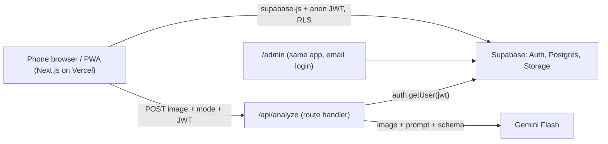

# BantayAsenso: PRD (v0.2, hackathon MVP)

Draft for the team to adjust. Items marked **[DECIDE]** are still open. Pitch sections are deferred until the technical side is settled.

## 1. Constraints

| Constraint | Effect on scope |
|---|---|
| 30-hour hackathon, 5 people | Build plan and roles in §12. Freeze at H28. |
| 3 min pitch + 2 min Q&A | The demo gets about 90 s. Build only what fits those 90 s, plus one thing to show if asked in Q&A. |
| Stack: Next.js PWA on Vercel + Supabase (**decided**) | No native app and no FastAPI. One Next.js route handler holds the AI key. |
| Judges try the app on their own phones | Scanning a sample sign must be easy and visible (§5, F7). The demo data needs a one-command reset (§11). The app must handle several judges at once (§10). |
| iPhone is the demo phone | Test on iOS Safari first (§9.4). Judges may still use Android, so test Chrome too. |
| No real contractors, budgets or contracts presented as fact | All 5 projects are fictional and labeled **Sample data** on screen. |
| Venue internet is unreliable | Sample images + canned AI responses, phone hotspot, backup video. |
| **[DECIDE]** Demo location (city/street) | The seed is built around one center point; changing it is a one-line edit (§9.3). |

## 2. Problem and users

**Problem:** Road works in Philippine cities run late or stall, and some are dangerous (*maling hukay*: no barricade, no warning light). Official project data exists but is published for engineers (contract codes, PDFs), so citizens can't use it on the spot.

**Hook figure:** delayed DPWH projects, using a real and cited number (COA annual audit reports on DPWH are a likely source; verify before use). *Deferred to the pitch side.*

| User | Need |
|---|---|
| Commuter or resident (primary) | Learn who is doing the work, what it costs and when it ends, in seconds, without typing. Report a hazard. |
| LGU or barangay staff (secondary, admin) | See citizen reports, acknowledge them, respond publicly, remove abuse. |

## 3. Goals and non-goals

**Goal:** In 90 s on stage, and on any judge's phone, show the full loop: **map → project details → scan a sign → flag a hazard → one-tap complaint.**

**Non-goals for the MVP:** real DPWH data import or scraping · actually sending complaints to government · usernames, profiles, XP or badges · push notifications · offline mode · app store release · face or plate blurring · contractor ratings · analytics dashboards · multiple languages.

## 4. Demo script (this is the spec)

1. **Open app** → full-screen tilted map; all 5 pins fit on one screen (1 green, 1 yellow, 2 red, 1 gray/unverified) under a "Sample data" banner.
2. **Tap a red pin** → card: title, contractor, budget ₱, target date, **"42 days overdue"**, **"No progress update in 60 days"**, **"17 neighbors flagged this"**.
3. **Tap Scan** → point the iPhone at the printed mini-billboard → in about 3 s a prefilled card appears → it matches an existing pin, which pulses.
4. **Hazard photo** of an open-trench printout → *"Possible issue: no barricade visible, no warning light. Please verify."* → the pin turns red.
5. **File complaint** → the iOS share sheet opens, prefilled.
6. *(Q&A only)* **Admin page** → the report appears → "Acknowledged" + a response → the response shows on the card.

## 5. Features

### P0 (needed for the demo)
| # | Feature | Acceptance |
|---|---|---|
| F1 | **Map home**: full-screen tilted MapLibre map, user location dot, colored pins, legend, large round **Scan** button at the bottom | The initial view fits the **verified** pins, so pins judges create elsewhere don't zoom the demo out |
| F2 | **Project card** (bottom sheet): fields, status + *reason*, urgency signals, **"I see this too" (+1)** | One +1 per user per project (enforced by the DB primary key) |
| F3 | **Sign scan**: photo → `/api/analyze` → **editable** prefilled form → save. Match on `contract_id`; if there is no match, insert a **gray unverified** project at the user's location | Reads all 3 printed samples in at least 4 of 5 tries; under 5 s from shutter to card on an iPhone over 4G |
| F4 | **Hazard check**: photo → AI flags → hazard report on the nearest project within 100 m, or a new unverified one | The disclaimer always shows |
| F5 | **Citizen update**: photo + note (≤500 chars) on a project | Shows on the card with a relative time, no name |
| F6 | **One-tap complaint**: `navigator.share()`, falling back to `mailto:` | Works on iOS Safari and Android Chrome |
| F7 | **Sample signs**: a visible "Try a sample sign/hazard" picker next to the camera. A sample carries its **preset location** (the location of its demo project), so judges anywhere get the demo result. If the API fails or takes over 10 s, load the canned JSON for that sample | The full flow works on a judge's phone without a printout, and still works when the AI is down |
| F8 | **Anonymous identity**: Supabase anonymous sign-in on first load | No `user_id` reachable from the client (§10) |

### P1 (requested; build after milestone M2 in §12)
| # | Feature | Acceptance |
|---|---|---|
| F9 | **Admin + response**: list reports newest first, set `open/acknowledged/resolved`, write a public response, **delete** abusive reports or pins | Only accounts in `admins` can see the page, update or delete |
| F10 | **Nearby projects** (no billboard): list sorted by distance | Works when GPS is denied (falls back to the map center) |

### P2 (roadmap only)
Google OAuth for citizens · captcha on anonymous sign-in · proximity check before reporting · face/plate blur · Tagalog UI · real DPWH/LGU data feed.

## 6. Status rules (single source of truth)

Computed in the `project_status` view; the client never computes colors. Checked top to bottom; the first match wins:

| Color | Rule |
|---|---|
| 🔴 red | An open (not `resolved`) hazard report exists |
| ⚪ gray | `verified = false` |
| 🔴 red | `progress_pct < 100` and `current_date > target_date` (overdue) |
| 🔴 red | `progress_pct < 100` and `last_progress_at < now() - 30 days` (stalled) |
| 🟡 yellow | `progress_pct < 100` and `target_date - current_date <= 30` |
| 🟢 green | otherwise |

The view also returns `days_overdue`, `days_since_progress`, `confirmations` and `open_reports` for the urgency line on the card.

## 7. AI

- **One Gemini Flash call per photo** through `@google/genai`, with `responseMimeType: "application/json"` + `responseSchema`. Two modes:
  - `sign` → `{contract_id, title, contractor, budget_php, start_date, target_date, implementing_office, unreadable_fields[]}`
  - `hazard` → `{open_excavation, barricade_visible, warning_light_visible, concerns[], summary}` (booleans may be `null` = can't tell)
- The user always confirms or edits fields before saving.
- The hazard result always shows: *"Automated check. This might be a problem; please verify. Not an official finding."*
- **Rate limits:** free-tier per-minute limits are low, and several judges scanning at once can hit `429`. Attach billing with a small spend cap before judging, and treat a `429` like a timeout (canned JSON for samples, manual entry for live photos).

## 8. Architecture



Reads and writes go **directly from the client to Supabase under RLS**. The only server code is `/api/analyze`, because the Gemini key must stay off the client.

## 9. Implementation

### 9.1 Stack and dependencies
| Need | Choice |
|---|---|
| App | `create-next-app` (App Router, TypeScript, Tailwind) + `app/manifest.ts` |
| Data/auth/files | `@supabase/supabase-js` (client-side only; no SSR auth needed) |
| Map | `maplibre-gl` used directly (no wrapper) + OpenFreeMap `liberty` style (free, no key) |
| AI | `@google/genai` |
| Bottom sheet, forms | Plain Tailwind (no UI kit) |

Env vars: `NEXT_PUBLIC_SUPABASE_URL`, `NEXT_PUBLIC_SUPABASE_ANON_KEY`, `GEMINI_API_KEY` (server only; never `NEXT_PUBLIC_`).

### 9.2 Repo layout
```
app/
  page.tsx                 map home + bottom-sheet card (F1, F2, F10)
  scan/page.tsx            ?mode=sign|hazard|update → capture/sample → form → save (F3–F5, F7)
  admin/page.tsx           email login + report queue (F9)
  api/analyze/route.ts     the only server code
  manifest.ts
lib/
  supabase.ts              client + ensureAnonSession()
  image.ts                 resize ≤1600px + JPEG re-encode (strips EXIF, converts HEIC)
public/samples/            sign-1..3.jpg, hazard-1..2.jpg + matching .json (canned result + preset lat/lng)
supabase/
  migrations/0001_init.sql tables, RLS, grants, view, nearest_project()
  seed.sql                 truncate + 5 demo projects + reports/+1s (also the judge reset)
  check.sql                asserts the 5 expected colors
```

### 9.3 Database
```sql
create table projects (
  id uuid primary key default gen_random_uuid(),
  contract_id text unique,                 -- null for citizen-created
  title text not null,
  contractor text,
  budget_php numeric,
  start_date date,
  target_date date,
  progress_pct int not null default 0 check (progress_pct between 0 and 100),
  last_progress_at timestamptz,
  lat double precision not null,
  lng double precision not null,
  verified boolean not null default false,
  created_at timestamptz not null default now()
);

create table reports (
  id uuid primary key default gen_random_uuid(),
  project_id uuid not null references projects on delete cascade,
  kind text not null check (kind in ('update','hazard')),
  note text check (char_length(note) <= 500),
  photo_path text,
  ai_flags jsonb,
  lat double precision,
  lng double precision,
  status text not null default 'open' check (status in ('open','acknowledged','resolved')),
  admin_response text,
  created_by uuid not null default auth.uid() references auth.users,
  created_at timestamptz not null default now()
);

create table confirmations (
  project_id uuid references projects on delete cascade,
  user_id uuid not null default auth.uid() references auth.users,
  primary key (project_id, user_id)
);

create table admins (user_id uuid primary key references auth.users);
```

- **`project_status` view** (`with (security_invoker = true)`) implements §6.
- **`nearest_project(lat, lng, max_m)`** is a SQL function using the haversine formula. `shortcut: full scan, fine for <1k rows; switch to PostGIS + index if real data is imported.`
- **Seed relocation:** `seed.sql` places the 5 projects as offsets from one center point (`with c(lat,lng) as (values (…))`), with dates relative to `current_date`. Choosing the demo location means editing that one line, and the colors stay correct on any day.

### 9.4 iPhone / iOS Safari notes
- **Camera:** `<input type="file" accept="image/*" capture="environment">` opens the rear camera directly. iOS may hand over HEIC files; `lib/image.ts` draws the photo onto a canvas and outputs JPEG, which also strips EXIF.
- **GPS:** `navigator.geolocation` requires HTTPS. When permission is denied, fall back to the map center.
- **Share:** `navigator.share({title, text, url})` must be called directly inside the tap handler. If you `await` before calling it, iOS rejects the call.
- **Testing on the phone:** use **Vercel preview URLs** (one per PR, HTTPS). Use `localhost` only for desktop UI work.
- **Install:** judges don't need to install. Show a QR code to the URL; Safari works as is. Add to Home Screen is optional.

## 10. Privacy and security (never cut)

- **No identities:** anonymous auth; `reports.created_by` and `confirmations.user_id` are excluded by column-level grants, so only RLS ever reads them.
- **RLS:** projects readable by all; signed-in users can insert only unverified projects (`with check (verified = false)`); reports and +1s can be inserted only as `auth.uid()`; only admins can update or delete reports and projects.
- **Photos:** stored in a `photos` bucket under random UUID paths (never user IDs); location comes from the Geolocation API, not EXIF.
- **`/api/analyze`:** rejects requests without a valid JWT, and anything that isn't `image/jpeg|png|webp` up to 5 MB or a known `mode`. Returns `4xx` and never forwards raw errors.
- **Judge load:** 5–10 phones at once is well within the free tiers for Vercel and Supabase. Gemini is the bottleneck (§7).
- **Known gaps:** faces or plates in photos (blur is P2); anonymous sign-up spam (captcha is P2); judges can post anything, so admins delete it (F9) and `seed.sql` resets everything.

## 11. Testing and demo readiness

- **`check.sql`:** a `do $$ … assert … $$` block that runs after `seed.sql` and fails unless each seeded project has its expected color. Run it on every migration change and on demo morning.
- **Scanner test set:** 3 printed billboards, 2 hazard printouts, and the same images on a laptop screen, under varied angles and lighting. Target: at least 4 of 5 correct reads on the iPhone.
- **Smoke test** (on the production URL, iPhone + one Android): 5 pins → card → +1 → live scan → sample scan → hazard → share → admin acknowledge + delete.
- **Judge reset:** run `seed.sql` before each judging slot.
- **Freeze at H28.** After the freeze, only S1 crash fixes are allowed, each followed by the smoke test again. Pan the demo area so map tiles are cached. Bring a hotspot. Record the backup video.
- **iPhone to projector:** a wired USB-C/Lightning to HDMI adapter (AirPlay depends on venue wifi). **[DECIDE]** confirm the projector input.

## 12. Build plan (30 h, 5 people)

### Roles
| Role | Owns |
|---|---|
| **T, tech lead (you)** | Supabase schema/RLS/view/seed/check, `/api/analyze`, Vercel + env, merging PRs, integration |
| **FE1** | Map home, pins, bottom-sheet card, +1, nearby list (F1, F2, F10) |
| **FE2** | Scan page: capture, `lib/image.ts`, edit form, save/match, complaint share (F3–F7 UI) |
| **FS** | AI prompts + schema tuning against the test set, sample images + canned JSON, admin page (F9) |
| **QA/Data** | Fictional seed content, printed billboards + hazard props, smoke-test runs on iPhone/Android, backup video; later the pitch deck |

### Timeline
| Hours | Work | Milestone at the end |
|---|---|---|
| H0–2 | T: repo, Supabase project, migration, seed, deploy to Vercel, share env. Everyone: clone and run. QA: write the 5 fictional projects. FS: shoot/collect the sample images | **M0:** prod URL loads on the iPhone |
| H2–10 | Parallel P0 work. T: `/api/analyze` + RLS. FE1: map + card from the view. FE2: capture + resize + form. FS: prompts against samples | **M1 (H10):** the iPhone shows 5 colored pins from Supabase; a sample sign returns JSON through the API |
| H10–18 | Wire the P0 flows end to end: save/match, hazard → nearest, update, share, sample fallback | **M2 (H18): demo script steps 1–5 work on the iPhone in production.** If this slips, cut P1. |
| H18–24 | P1: admin (FS), nearby list (FE1). Polish: tilt, pin pulse, big buttons (FE2). T: hardening, `429`/timeout paths. QA: full smoke runs | **M3:** P1 done, smoke test passes |
| H24–28 | Bug fixes only, AI tuning with printouts, judge-load test (5 phones at once) | **Freeze at H28** |
| H28–30 | Reset seed, smoke test, record backup video, rehearse | Stage |

Sleep: take turns in pairs so that someone who can deploy (T or FS) is always awake. Commit to `main` only through PRs; each PR gets a Vercel preview to test on the iPhone.

## 13. Pitch (3:00), *deferred*

Outline kept for later: problem + hook figure (0:20) → who it hurts (0:15) → live demo §4 (1:30) → feasibility (0:25) → impact (0:20) → ask (0:10).

## 14. Q&A prep, *deferred*

Technical answers to have ready: AI accuracy (the user confirms fields; the hazard check is advisory) · fake reports (geotag, +1s, gray unverified pins, admin delete) · privacy (anonymous accounts, hidden user IDs, EXIF stripped) · cost (free tiers + a small Gemini spend cap) · roadmap (official data feeds → LGU dashboard → other public works).

## 15. Open decisions

1. Demo location (a one-line change in `seed.sql`).
2. Projector input for the iPhone (HDMI adapter type).
3. Hook figure source (deferred, pitch side).
